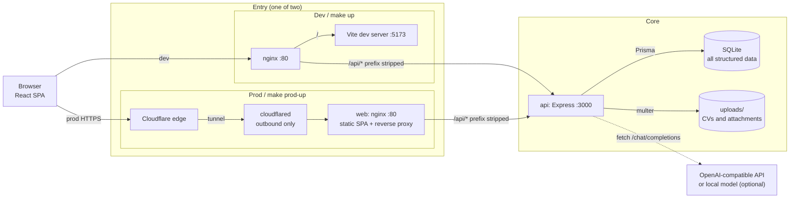
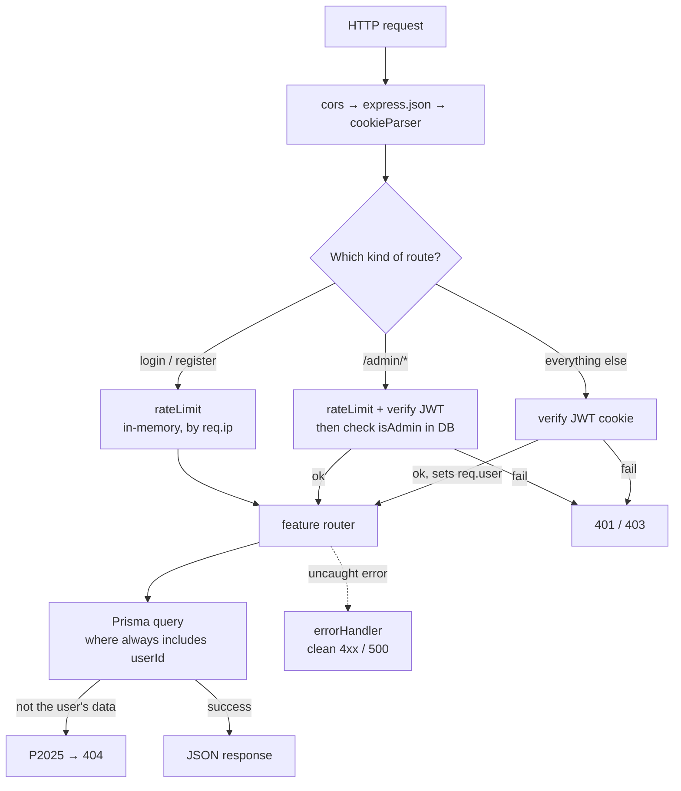
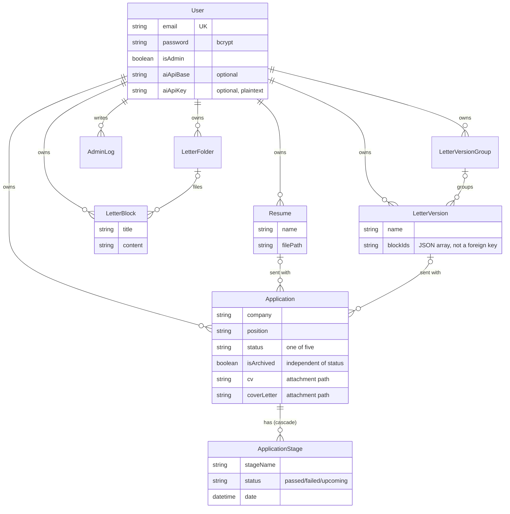
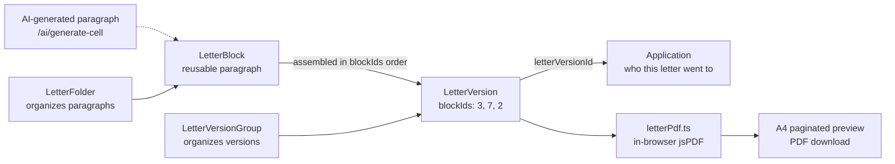
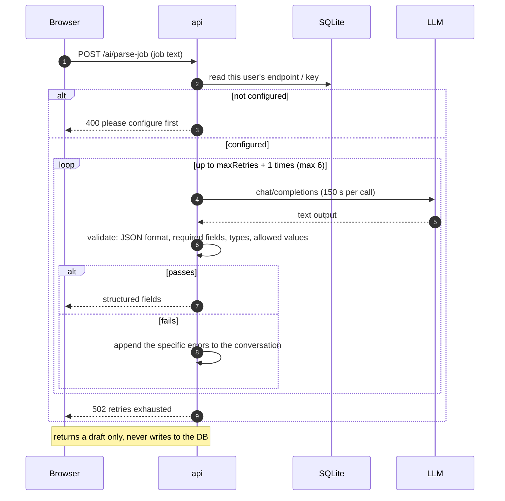
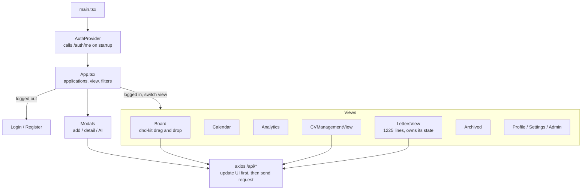

# Candivana Architecture Notes (First Principles)

> The repo directory is `scandiva`; the product is **Candivana**. Based on the code at commit `565d09b`.

**In one sentence: one Node process + one SQLite file + one uploads folder, wrapped in nginx.** Everything else is an interface to those three.

---

## 1. The problem

A job seeker tracks dozens to hundreds of applications over weeks or months: which stage each one is at, when the next interview is, which CV and which letter went out. This data is personal, and it has to be portable once the job search is over.

## 2. Deriving the architecture from basic facts

| Irreducible fact | Resulting design | Code |
|---|---|---|
| One person's data is small (a few hundred rows) | SQLite is enough; the frontend loads everything at once and filters/searches in the browser | [schema.prisma:6](backend/prisma/schema.prisma#L6), [App.tsx:241](frontend/src/App.tsx#L241) |
| The data is personal and must be portable | Self-hosted; all state lives in two places, "DB file + uploads directory", so backup means copying them | [docker-compose.yml:22](docker-compose.yml#L22) |
| One machine may host several accounts that must never see each other | Every query carries `userId`; file downloads check ownership in the DB first | [applications.routes.js:60](backend/src/routes/applications.routes.js#L60), [uploads.routes.js:15](backend/src/routes/uploads.routes.js#L15) |
| Cover letters are mostly the same few paragraphs rearranged | Paragraphs (Block) and arrangements (Version) are stored separately | [schema.prisma:50](backend/prisma/schema.prisma#L50) |
| "Which stage" and "put away" are independent dimensions | `status` and `isArchived` are separate fields; archiving never overwrites status | [applications.routes.js:58](backend/src/routes/applications.routes.js#L58) |
| LLM output is untrusted and responses are slow | The server validates output and feeds errors back for a retry; timeout raised to 150 s | [ai.routes.js:131](backend/src/routes/ai.routes.js#L131) |
| AI is not a core feature | Each user brings their own endpoint/key; without one, AI returns 400 and nothing else is affected | [aiClient.js:4](backend/src/lib/aiClient.js#L4) |

### Assumptions this architecture bets on

These are not facts but design bets. When a condition changes, the dependent design has to be rethought:

| Assumption | Design that depends on it | When it breaks |
|---|---|---|
| A single machine and a single API process are enough | SQLite, in-memory rate limiter | When horizontal scaling is needed |
| The person deploying is the person using it | Unrestricted AI endpoint, API key stored in plaintext | When registration opens to strangers |
| ~~No background jobs needed~~ | No queue, cron or email | **Broken by Job Scout**: an in-process scheduler now fetches saved searches (`backend/src/scrapers/scheduler.js`); still no queue or email |
| No shareable URLs needed | Page switching is React state only, no router | When deep links or the browser back button are wanted |

---

## 3. System overview

Same-origin is the key: the browser only talks to one host and nginx forwards `/api/` to the backend, so the JWT cookie works with `sameSite: lax`. nginx strips the prefix, so backend routes themselves have no `/api`.

| | Dev stack (`make up`) | Prod stack (`make prod-up`) |
|---|---|---|
| Compose file | [docker-compose.yml](docker-compose.yml) | [docker-compose.prod.yml](docker-compose.prod.yml) |
| Public entry | host port 80 | No open ports; Cloudflare Tunnel |
| Frontend | Vite dev server + HMR | Built bundle served by nginx |
| Backend | nodemon, source mounted | `npm start` + healthcheck |
| Data location | `./data`, `./uploads` (bind mounts) | Docker named volumes `api-data`, `api-uploads` |
| Registration | Open by default | Closed by default |

CI: only when backend tests and the frontend build pass, and the repo variable `DEPLOY_ENABLED` is true, does it SSH into the host and run [scripts/deploy.sh](scripts/deploy.sh) ([ci.yml](.github/workflows/ci.yml)).

---

## 4. Backend: one pipeline, eight routers

There is no service or repository layer: routers call Prisma directly. At this scale that's a reasonable omission; only shared logic is pulled into `lib/`.

| Router | Path | Responsibility |
|---|---|---|
| [auth](backend/src/routes/auth.routes.js) | `/auth/*` | Register/login, profile settings, stats, account deletion |
| [applications](backend/src/routes/applications.routes.js) | `/applications` | Application CRUD, linking CVs and letter versions |
| [stages](backend/src/routes/stages.routes.js) | `/applications/:id/stages`, `/stages/:id` | Interview stages |
| [resumes](backend/src/routes/resumes.routes.js) | `/resumes` | CV library (PDF/DOC/DOCX only, 10 MB) |
| [uploads](backend/src/routes/uploads.routes.js) | `/uploads/*` | Owner-only file downloads |
| [letters](backend/src/routes/letters.routes.js) | `/letter-blocks`, `/letter-versions`, `/letter-folders`, `/letter-version-groups` | Cover-letter building blocks |
| [ai](backend/src/routes/ai.routes.js) | `/ai/*` | Settings, job parsing, paragraph generation, board summary |
| [admin](backend/src/routes/admin.routes.js) | `/admin/*` | System stats and audit log |

---

## 5. Data model

`Application` is the center: one application ties "where it is" (Stage) to "what was sent" (Resume, LetterVersion). Valid `status` values are enforced by [validators.js:36](backend/src/lib/validators.js#L36), because Prisma's SQLite provider doesn't support enums.

---

## 6. The most distinctive part: cover-letter blocks

- **Order is data**: a version only stores a list of ids, so editing a paragraph once updates every version that references it.
- **The cost**: `blockIds` is a JSON string, so the database doesn't know it's a reference; deleting a paragraph has to manually remove its id from every version ([letters.routes.js:92](backend/src/routes/letters.routes.js#L92)).
- **PDFs are generated in the frontend**: preview and export share the same layout constants ([letterPdf.ts:5](frontend/src/lib/letterPdf.ts#L5)), so what you see is what you get, and the server needs no PDF engine.

---

## 7. AI: locking untrusted output inside a validation loop

The key point is that **AI routes never write application data directly**: their output is only a form draft, so all data still goes through the same validation path. `generate-cell` uses the same loop and actually measures length (characters for CJK, words for other languages) before feeding it back to the model. `summary` is free text and isn't retried.

---

## 8. Frontend: one big component owns all state

No router, no Redux or React Query: `App.tsx` holds the application list and passes it down via props. Almost the only data shared across features is "the application list" and "the current user", so this is enough; `LettersView` and `CVManagementView` each fetch their own data.

---

## 9. If you cut 90%, what's left?

`Application` + `ApplicationStage` + the board + account isolation. That's the product's backbone.

The rest, ranked by irreplaceability: cover-letter blocks (the real differentiator) > CV library > calendar and analytics (just other views of the same data) > AI (optional) > Admin.

---

## 10. Architectural tensions

All confirmed in the code. The first few are places where **the assumptions and the implementation don't match**; the rest are small leftovers.

| # | Observation | Why it matters | Location |
|---|---|---|---|
| 1 | Prod nginx doesn't set `proxy_read_timeout` (default 60 s), but a single AI call is allowed 150 s; the comment "nginx allows 180s" only holds for the dev config | Slow models get cut off in prod, but it can't be reproduced in dev | [frontend/nginx.conf:11](frontend/nginx.conf#L11), [ai.routes.js:136](backend/src/routes/ai.routes.js#L136) |
| 2 | `trust proxy: true` plus rate limiting on `req.ip` means the leftmost `X-Forwarded-For` is client-controlled; the tests themselves rely on this to bypass the limiter. The Map keys are also never evicted | Brute-force protection can be bypassed, and spoofed IPs make memory grow unbounded | [app.js:19](backend/src/app.js#L19), [rateLimit.js:8](backend/src/middleware/rateLimit.js#L8), [helpers.js:10](backend/tests/helpers.js#L10) |
| 3 | `aiApiBase` isn't validated; the server connects to any URL and returns the first 200 chars of its error body | SSRF in a multi-user setup; fine for single-user self-hosting, and local models need internal access anyway | [ai.routes.js:37](backend/src/routes/ai.routes.js#L37), [aiClient.js:41](backend/src/lib/aiClient.js#L41) |
| 4 | Deleting an account only removes Resume files; application attachments (`cv`, `coverLetter`) stay on disk, and the same goes for deleting a single application | Contradicts the "your data is yours" promise; private documents are left behind | [auth.routes.js:144](backend/src/routes/auth.routes.js#L144), [applications.routes.js:70](backend/src/routes/applications.routes.js#L70) |
| 5 | The README quick start (`make up`) runs the dev stack: nodemon, Vite, cookies without `secure` | Self-hosters actually run in dev mode long term | [Makefile:14](Makefile#L14) |
| 6 | Schema uses `prisma db push` with no migration files, run on every startup | Data-losing schema changes make the container fail to start, with no version history | [docker-compose.prod.yml:24](docker-compose.prod.yml#L24) |
| 7 | The drag-and-drop PUT has no error handling | On request failure the UI and DB disagree until a reload | [App.tsx:141](frontend/src/App.tsx#L141) |
| 8 | JWTs are stateless; after a password change the old token stays valid for up to 24 hours | Changing the password after an account takeover doesn't kick the attacker out immediately | [auth.js:9](backend/src/middleware/auth.js#L9) |
| 9 | `aiApiKey` is stored in plaintext in SQLite | A leaked backup means a leaked key | [schema.prisma:23](backend/prisma/schema.prisma#L23) |

**Leftovers (safe to remove)**: the `notify*` preferences are saved but nothing in the backend reads them, and there's no email feature; `@hello-pangea/dnd` is never imported (dnd-kit is what's used); nginx's `/socket.io/` block has no matching code; `Application.previousStatus` is marked deprecated.

---

## 11. Suggested next steps

Ordered by return on effort:

1. **Add `proxy_read_timeout 180s`** to [frontend/nginx.conf](frontend/nginx.conf). A one-line fix that resolves #1.
2. **Set `trust proxy` to the actual number of proxy hops**, and evict expired rate-limit keys periodically; make the tests isolate the limiter via injection instead.
3. **Delete attachments when deleting applications and accounts**, keeping the data-ownership promise.
4. **Remove the leftovers above**, especially the `notify*` toggles: users currently think they do something.
5. **Take a position on #3 and #9**: if "deployer is the user" stays, write it into SECURITY.md; if registration opens up, add endpoint restrictions and key encryption.

## Open questions

- Is the target single-user self-hosting, or one host serving many users? That decides how serious #3, #8 and #9 are.
- How slow are the models actually used in prod? Cloudflare has its own response-time limit, and the real deployment config isn't visible in the repo; it needs measuring.
- Should the quick start use the prod image, just without the tunnel?
