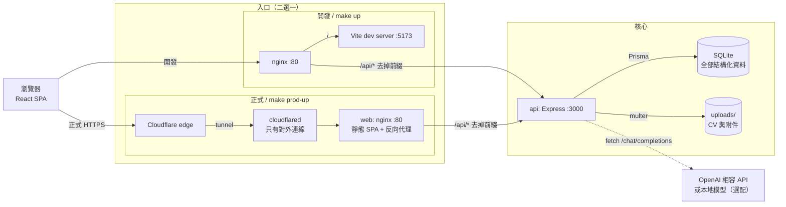
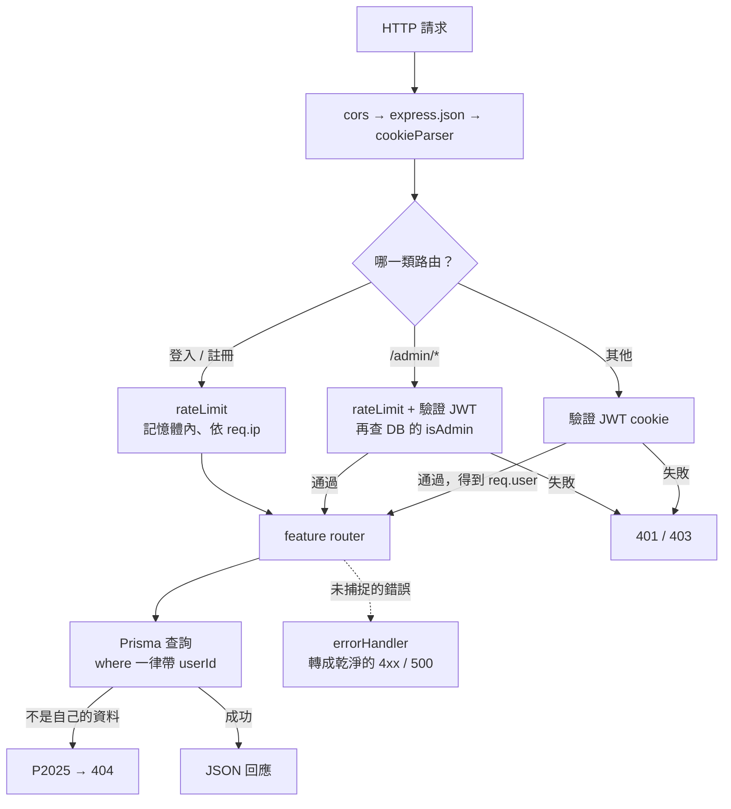
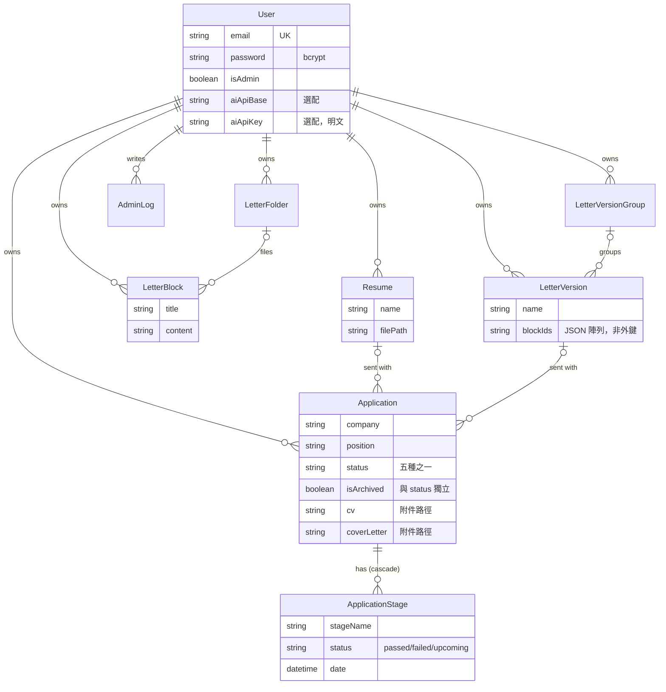
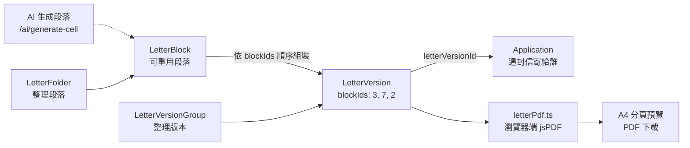
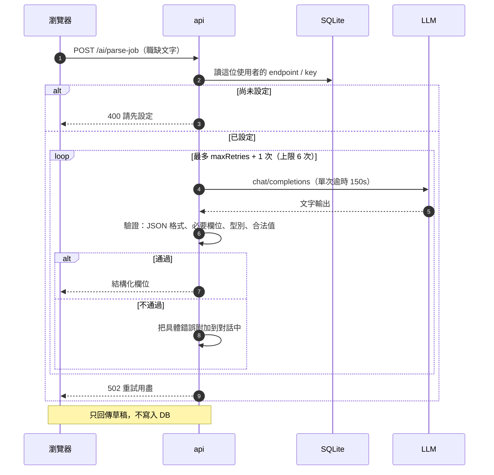
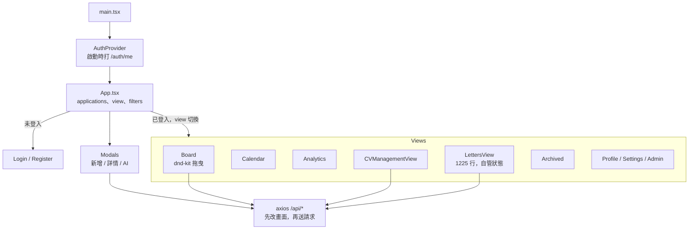

# Candivana 架構筆記（First Principles）

> repo 目錄叫 `scandiva`，產品名是 **Candivana**。內容依 commit `565d09b` 的程式碼整理。

**一句話：一個 Node 行程 + 一個 SQLite 檔 + 一個上傳資料夾，外面包一層 nginx。** 其他東西都是這三樣的介面。

---

## 1. 問題本身

一個求職者要在幾週到幾個月內，追蹤幾十到幾百筆申請：每筆走到哪一關、下次面試何時、寄出去的是哪份 CV 和哪封信。這些資料很私人，而且求職結束後要能整包帶走。

## 2. 從基本事實推出架構

| 不可再拆的事實 | 推出的設計 | 程式碼 |
|---|---|---|
| 一個人的資料量很小（幾百筆） | SQLite 就夠；前端一次載入全部，篩選和搜尋都在瀏覽器做 | [schema.prisma:6](backend/prisma/schema.prisma#L6)、[App.tsx:241](frontend/src/App.tsx#L241) |
| 資料私人，且要能帶走 | 自架；全部狀態只有「DB 檔 + 上傳目錄」兩個地方，備份就是複製它們 | [docker-compose.yml:22](docker-compose.yml#L22) |
| 同一台機器可能有多個帳號，彼此絕不能互看 | 每個查詢都帶 `userId`；檔案下載也要先查 DB 確認擁有者 | [applications.routes.js:60](backend/src/routes/applications.routes.js#L60)、[uploads.routes.js:15](backend/src/routes/uploads.routes.js#L15) |
| 動機信大多是同幾段話重新排列 | 段落（Block）與排列（Version）分開存 | [schema.prisma:50](backend/prisma/schema.prisma#L50) |
| 「走到哪一關」和「收起來不看」是兩個獨立維度 | `status` 與 `isArchived` 是兩個欄位，封存不會蓋掉狀態 | [applications.routes.js:58](backend/src/routes/applications.routes.js#L58) |
| LLM 的輸出不可信、回應又慢 | 伺服器驗證輸出，失敗就把錯誤餵回去重試；逾時放寬到 150 秒 | [ai.routes.js:131](backend/src/routes/ai.routes.js#L131) |
| AI 不是核心功能 | 每位使用者自帶 endpoint/key；沒設定只回 400，其他功能不受影響 | [aiClient.js:4](backend/src/lib/aiClient.js#L4) |

### 這個架構押注的假設

這些不是事實，是設計上的賭注。條件一變，對應的設計就要重想：

| 假設 | 依賴它的設計 | 什麼時候會破 |
|---|---|---|
| 單機、單一 API 行程就夠 | SQLite、記憶體內的 rate limiter | 需要水平擴展時 |
| 部署的人就是使用的人 | AI endpoint 不設限、API key 明文存放 | 開放陌生人註冊時 |
| 不需要背景工作 | 沒有 queue、cron、寄信 | 真的要做提醒通知時 |
| 不需要可分享的網址 | 頁面切換只靠 React state，沒有 router | 想要深連結或瀏覽器上一頁時 |

---

## 3. 系統全貌

同源是關鍵：瀏覽器只跟同一個 host 講話，`/api/` 由 nginx 轉給後端，所以 JWT cookie 用 `sameSite: lax` 就能運作。前綴會被 nginx 拿掉，後端路由本身沒有 `/api`。

| | 開發 stack（`make up`） | 正式 stack（`make prod-up`） |
|---|---|---|
| Compose 檔 | [docker-compose.yml](docker-compose.yml) | [docker-compose.prod.yml](docker-compose.prod.yml) |
| 對外入口 | host port 80 | 不開任何 port，靠 Cloudflare Tunnel |
| 前端 | Vite dev server + HMR | 打包後由 nginx 提供 |
| 後端 | nodemon，掛載原始碼 | `npm start` + healthcheck |
| 資料位置 | `./data`、`./uploads`（bind mount） | Docker named volume `api-data`、`api-uploads` |
| 註冊 | 預設開放 | 預設關閉 |

CI：後端測試 + 前端 build 都過，且 repo 變數 `DEPLOY_ENABLED` 為 true，才 SSH 到主機跑 [scripts/deploy.sh](scripts/deploy.sh)（[ci.yml](.github/workflows/ci.yml)）。

---

## 4. 後端：一條管線，八個 router

沒有 service 或 repository 層：router 直接呼叫 Prisma。以這個規模來說這是合理的省略，共用邏輯才抽到 `lib/`。

| Router | 路徑 | 職責 |
|---|---|---|
| [auth](backend/src/routes/auth.routes.js) | `/auth/*` | 註冊登入、個人設定、統計、刪除帳號 |
| [applications](backend/src/routes/applications.routes.js) | `/applications` | 申請的 CRUD，連結 CV 與信件版本 |
| [stages](backend/src/routes/stages.routes.js) | `/applications/:id/stages`、`/stages/:id` | 面試階段 |
| [resumes](backend/src/routes/resumes.routes.js) | `/resumes` | CV 庫（限 PDF/DOC/DOCX，10MB） |
| [uploads](backend/src/routes/uploads.routes.js) | `/uploads/*` | 只給擁有者下載檔案 |
| [letters](backend/src/routes/letters.routes.js) | `/letter-blocks`、`/letter-versions`、`/letter-folders`、`/letter-version-groups` | 動機信的積木系統 |
| [ai](backend/src/routes/ai.routes.js) | `/ai/*` | 設定、解析職缺、生成段落、看板摘要 |
| [admin](backend/src/routes/admin.routes.js) | `/admin/*` | 系統統計與稽核紀錄 |

---

## 5. 資料模型

`Application` 是中心：一筆申請把「走到哪」（Stage）和「寄了什麼」（Resume、LetterVersion）綁在一起。`status` 的合法值由 [validators.js:36](backend/src/lib/validators.js#L36) 把關，因為 Prisma 的 SQLite 不支援 enum。

---

## 6. 最有特色的部分：動機信積木

- **順序就是資料**：版本只存一串 id，所以同一段落改一次，所有引用它的版本都會更新。
- **代價**：`blockIds` 是 JSON 字串，資料庫不知道它是參照，刪段落時得手動清掉每個版本裡的 id（[letters.routes.js:92](backend/src/routes/letters.routes.js#L92)）。
- **PDF 在前端產生**：預覽和匯出共用同一份版面常數（[letterPdf.ts:5](frontend/src/lib/letterPdf.ts#L5)），所見即所得，伺服器也不用裝 PDF 引擎。

---

## 7. AI：把不可信的輸出關進驗證迴圈

重點是 **AI 路由不直接寫入申請資料**：輸出只是表單草稿，所以所有資料仍然經過同一條驗證路徑。`generate-cell` 也走同樣的迴圈，並會實際計算長度（中日韓算字數、其他語言算詞數）再回饋給模型。`summary` 是自由文字，不重試。

---

## 8. 前端：一個大元件管全部狀態

沒有 router、沒有 Redux 或 React Query：`App.tsx` 持有申請列表，用 props 往下傳。功能之間共用的資料幾乎只有「申請列表」和「當前使用者」，所以這樣夠用；`LettersView` 和 `CVManagementView` 各自抓自己的資料。

---

## 9. 如果要砍掉 90%，還剩什麼？

`Application` + `ApplicationStage` + 看板 + 帳號隔離。這是產品的骨幹。

其餘按「不可取代性」排序：動機信積木（真正的差異化）> CV 庫 > 行事曆與分析（只是同一份資料的另一種檢視）> AI（選配）> Admin。

---

## 10. 架構上的張力

以下都已在程式碼中確認。前幾項是**假設和實作對不上**的地方，後面是小的殘留物。

| # | 現象 | 為什麼重要 | 位置 |
|---|---|---|---|
| 1 | 正式環境的 nginx 沒設 `proxy_read_timeout`（預設 60 秒），但 AI 單次呼叫允許 150 秒；註解寫的「nginx allows 180s」只對開發設定成立 | 慢模型在正式環境會被切斷，開發環境卻重現不了 | [frontend/nginx.conf:11](frontend/nginx.conf#L11)、[ai.routes.js:136](backend/src/routes/ai.routes.js#L136) |
| 2 | `trust proxy: true` 加上用 `req.ip` 限流，代表最左邊的 `X-Forwarded-For` 由客戶端決定；測試本身就靠這點繞過限流。此外 Map 的 key 從不清除 | 暴力破解防護可被繞過，偽造 IP 還會讓記憶體持續增長 | [app.js:19](backend/src/app.js#L19)、[rateLimit.js:8](backend/src/middleware/rateLimit.js#L8)、[helpers.js:10](backend/tests/helpers.js#L10) |
| 3 | `aiApiBase` 沒有驗證，伺服器會去連任意 URL，並回傳對方錯誤內容的前 200 字 | 多人環境就是 SSRF；單人自架沒事，且支援本地模型本來就需要連內網 | [ai.routes.js:37](backend/src/routes/ai.routes.js#L37)、[aiClient.js:41](backend/src/lib/aiClient.js#L41) |
| 4 | 刪帳號只清 Resume 的檔案，申請附件（`cv`、`coverLetter`）留在磁碟；刪單筆申請也一樣 | 與「資料是你的」的承諾相違，私人文件會殘留 | [auth.routes.js:144](backend/src/routes/auth.routes.js#L144)、[applications.routes.js:70](backend/src/routes/applications.routes.js#L70) |
| 5 | README 的 quick start（`make up`）跑的是開發 stack：nodemon、Vite、cookie 不帶 `secure` | 自架使用者實際上長期跑在開發模式 | [Makefile:14](Makefile#L14) |
| 6 | Schema 用 `prisma db push`，沒有 migration 檔，每次啟動都執行 | 會造成資料遺失的 schema 變更會讓容器啟動失敗，且沒有版本紀錄可循 | [docker-compose.prod.yml:24](docker-compose.prod.yml#L24) |
| 7 | 拖曳的 PUT 沒有錯誤處理 | 請求失敗時畫面和資料庫會不一致，直到重新整理 | [App.tsx:141](frontend/src/App.tsx#L141) |
| 8 | JWT 無狀態，改密碼後舊 token 仍有效至多 24 小時 | 帳號被盜時改密碼無法立即踢掉對方 | [auth.js:9](backend/src/middleware/auth.js#L9) |
| 9 | `aiApiKey` 明文存在 SQLite | 備份檔外流等於 key 外流 | [schema.prisma:23](backend/prisma/schema.prisma#L23) |

**殘留物（可直接清掉）**：`notify*` 偏好會被儲存，但後端沒有任何程式讀取，也沒有寄信功能；`@hello-pangea/dnd` 沒被 import（實際用的是 dnd-kit）；nginx 的 `/socket.io/` 區段沒有對應的程式；`Application.previousStatus` 已標記 deprecated。

---

## 11. 下一步建議

依投入產出排序：

1. **補上 `proxy_read_timeout 180s`** 到 [frontend/nginx.conf](frontend/nginx.conf)。一行修正，直接解決第 1 項。
2. **把 `trust proxy` 改成實際的代理層數**，並定期清除過期的限流 key；測試改用可注入的方式隔離限流。
3. **刪除申請和帳號時一併清除附件**，兌現資料所有權的承諾。
4. **清掉上面的殘留物**，尤其 `notify*` 開關：使用者現在會以為它們有作用。
5. **決定第 3、9 項的立場**：若維持「部署者即使用者」，寫進 SECURITY.md；若要開放註冊，就加上 endpoint 限制和 key 加密。

## 待釐清的問題

- 目標使用情境是單人自架，還是一台主機服務多人？這決定第 3、8、9 項的嚴重程度。
- 正式環境實際會用到多慢的模型？Cloudflare 本身也有回應時間上限，repo 裡看不出實際部署的設定，需要實測。
- Quick start 是否該改用正式映像檔，只是不走 tunnel？
