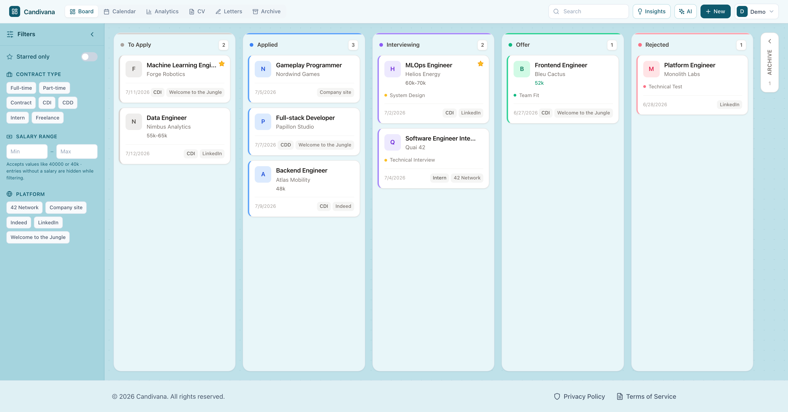
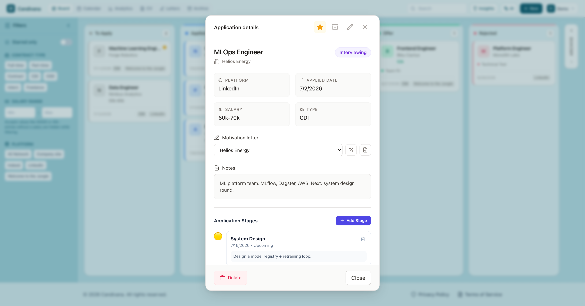
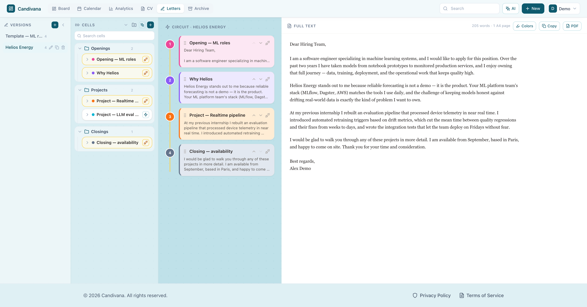
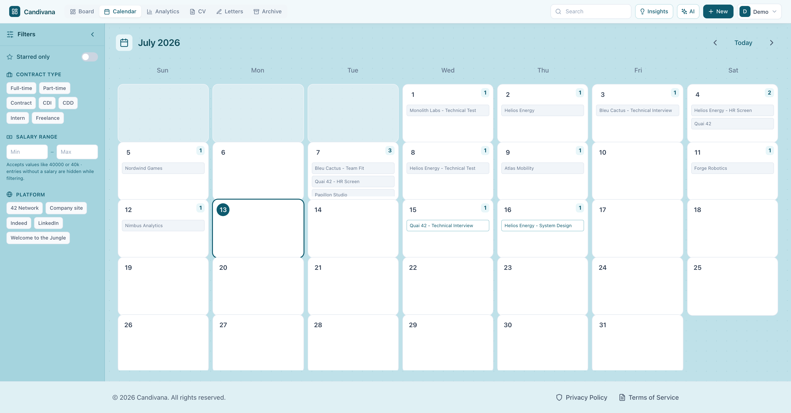
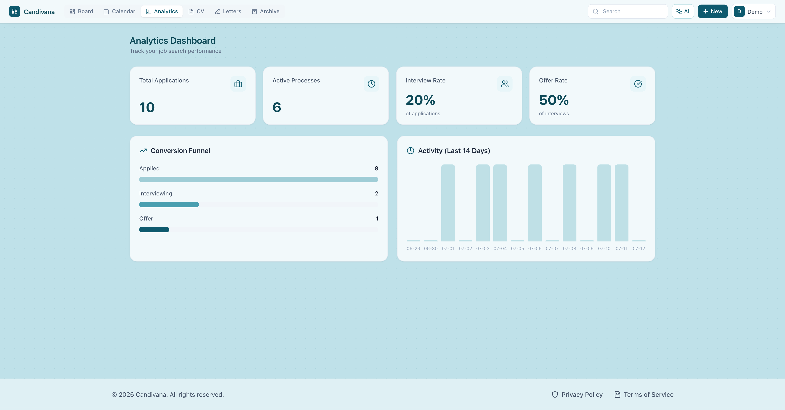

# Candivana

**A self-hosted platform that streamlines your job search — and your data is yours.**

Job hunting is a memory game you shouldn't have to play: which companies you applied to, which letter went where, who answered, what's next. Candivana takes that load off your mind. Every application, every interview stage, and every version of your motivation letter lives in one place — a place you run yourself, on your own machine, in files you can copy, back up, or delete at any time.

No cloud account. No subscription. No telemetry. No one training on your career.




*All screenshots show a demo account with fictional data.*

---

## The Board — your whole search at a glance

The home view is a Kanban board with five columns: **To Apply → Applied → Interviewing → Offer / Rejected**.

- **Drag a card to update it.** Moving an application to another stage is one gesture — no forms, no dialogs. The UI updates instantly.
- **Archive without losing anything.** Drag a card onto the archive strip and it leaves the board — but keeps its status, so when you restore it later it lands exactly where it was. Rejected-then-reopened processes don't turn into data archaeology.
- **Star what matters.** Flag the applications you care about most, right from the card.
- **Search as you type.** The header search filters the board live by company or position.

### Filters that understand a job search

A collapsible sidebar filters every list view (board, calendar, archive):

- **Starred only** — focus mode for your top targets.
- **Contract type** — Full-time, Part-time, Contract, CDI, CDD, Intern, Freelance (French contract types are first-class, not an afterthought).
- **Salary range** — type `40k` or `40000`, both work. Applications without salary info are hidden while a salary filter is active, so the results you see are real.
- **Platform** — filter chips are generated from *your* data: if you've applied via LinkedIn, Welcome to the Jungle, and 42, those are your chips. No preset list to ignore.
- Collapsed, the sidebar becomes a slim icon rail with a dot on each filter group that's active and a badge counting active filters — you always know when you're looking at a filtered view.

## Application details — everything about one process, in one card

Click any card to open its detail view:

- **All the facts**: company, position, status, platform, contract type, salary, job link, free-form notes — viewable at a glance, editable in place.
- **Stage timeline**: record each round (HR screen, technical test, on-site…) with its date, status (passed / failed / upcoming) and notes. The next thing you have to do is always written down — not in your head.
- **Documents**: upload the exact CV and cover letter you sent (PDF/DOC/DOCX) and reopen them anytime. No more "which version did I send them?"
- **Linked motivation letter**: pick one of your letter versions from a dropdown. From then on it's one click to jump to that letter or to download its PDF — straight from the application.
- Star, archive, or delete (with confirmation) without leaving the modal.



## Letters — modular motivation letters with version control

The most tedious part of a job search is writing the same letter twenty times with one paragraph changed. Candivana treats letters like a circuit, not a document:

- **Cells** are reusable paragraphs — your intro, a project story, a closing. Write each once. Organize them in **folders** with drag-and-drop, reorder folders, search across titles and content. Cells stay collapsed to a single row until you expand them, so a large library stays scannable.
- **Versions** are named chains of cells — typically one per company. Organize versions into collapsible groups, drag versions between groups, and keep ungrouped drafts at the root. **Duplicate a version in one click** to reuse it as a template: the copy stays in the same group and opens in rename mode.
- **Edit once, update everywhere.** A cell edited in the library changes in every version that uses it — fix a typo in your intro and all twenty letters are fixed.
- **Wire, don't rewrite.** Plug cells in and out of the current version, drag to reorder, and watch the assembled letter update live. Optionally colorize the preview to see which paragraph comes from which cell.
- **What you see is what prints.** The preview shows the letter with the *exact* A4 page breaks of the exported PDF — dashed markers where each page ends (honest even when a break lands mid-paragraph), a live word count, and a page count that turns amber the moment you spill past one page. The preview and the PDF can never disagree.
- **Export or copy.** Download the letter as a cleanly typeset A4 PDF (generated locally in your browser — the text never leaves your machine) or copy the full text to the clipboard.
- **AI drafts on your terms.** Describe a paragraph and set a word budget (min/max) and AI writes a draft cell — which you then edit like any other cell. Word limits are enforced properly for CJK text too.



## Calendar — your search over time

A monthly calendar shows your activity where it happened: the days you applied and every interview stage, color-coded by outcome. Click a day to see everything scheduled or recorded on it. Useful both for "what's coming this week" and for noticing that you haven't applied to anything in ten days.



## Analytics — an honest look at your funnel

- **Stat cards**: total applications, active processes, interview rate, offer rate.
- **Conversion funnel**: Applied → Interviewing → Offer, so you can see where things stall — is it your CV (few interviews) or your interviews (few offers)?
- **Activity chart** for the last 14 days to keep your pace visible.



## CV Library

Keep every CV variant in one place: upload, preview in-app, rename, download, delete. Combined with the per-application document uploads, you always know exactly what each company saw.

## AI — only where it actually helps

Three features, no more. All optional. And you decide where the AI runs:

- **Your own API key** — point Candivana at any OpenAI-compatible endpoint (OpenAI, NVIDIA NIM, Mistral, OpenRouter…) with your key. Your job data is exchanged directly between your server and the provider you chose, under your account and their terms — never through anyone else's middleman.
- **Or a local LLM** — set the base URL to an OpenAI-compatible local server (Ollama, LM Studio, llama.cpp, vLLM…) and the AI features run entirely on your hardware. Nothing about your job search ever leaves your machine.

What the three features do:

1. **Paste a job posting, get a filled form.** The AI add flow extracts company, position, link, platform, salary, contract type and a one-line notes summary — you review, fix, and save. No retyping from job boards.
2. **Draft a letter cell** from a description and a word budget.
3. **Board insights** — an on-demand summary of your current pipeline.

The integration is built to be reliable, not flashy: strict output validation with automatic retry (the model is told exactly what it got wrong), configurable retry count, and timeouts sized for slow reasoning models — local and small models included. **If you never configure an endpoint, no AI code runs and every other feature works exactly the same.**

## Your data is yours

- **Self-hosted**: the whole stack runs on your machine (or your server) via Docker Compose.
- **Inspectable storage**: everything is stored under `./data/` (SQLite) and `./uploads/` (documents) in a local deployment. Copy those two directories and you have backed up your search.
- **One-click export**: download all your application data as JSON from Settings, anytime.
- **Full deletion**: delete your account and its data from Settings — it's your database, nothing lingers.
- **Local PDF generation**: letters are rendered to PDF in the browser; the text is never sent anywhere.
- **Bring your own AI**: the optional AI features talk only to the endpoint you configure — your API key, or a fully local LLM so nothing leaves your machine.

## The small things

The details that make daily use pleasant:

- Editors never close on a stray click outside — a half-written paragraph can only be discarded by pressing Cancel.
- Every rename is inline: click the pencil, type, press Enter.
- Destructive actions (deleting an application) ask for confirmation; cheap actions (starring, moving, archiving) never do.
- Actions appear on hover, so lists stay clean until you need them.
- Changes apply optimistically — the UI responds immediately, the server catches up.
- Sidebars collapse to icon rails with live badges, keeping small screens usable.

## Quick start

**Prerequisites**: Docker with the Compose v2 plugin, GNU Make, and OpenSSL. Windows users can run the commands inside WSL2.

```bash
git clone https://github.com/swangarch/candivana.git
cd candivana

make init        # creates .env with a random local JWT signing secret
make up          # builds and starts the stack in the background
```

The first build can take a few minutes. Check startup with:

```bash
docker compose ps
docker compose logs -f api web nginx
```

When all three services are running, open **http://localhost**, register your own account, and start tracking. Candivana ships with **no default users or passwords**.

To stop or update the local stack:

```bash
make down
git pull
make build
```

Your persistent local data lives in `./data/` and `./uploads/`. `make down`, rebuilds, and application upgrades preserve both directories. Back them up before major upgrades. They are ignored by Git and excluded from Docker build contexts.

To promote an existing registered account to administrator:

```bash
make set-admin EMAIL=you@example.com
```

To enable AI features, open **AI Settings** and enter an OpenAI-compatible base URL, API key, and model. AI is optional; the rest of the application works without it.

**Production**: a separate stack serves the app through a Cloudflare Tunnel — see [DEPLOY.md](DEPLOY.md), then `cp .env.production.example .env.production` and `make prod-up`. Self-registration is disabled by default in production; create the first administrator with the documented server-side command.

**Useful commands**: `make init` / `make up` / `make down` / `make build` / `make logs` / `make clean`.

### Troubleshooting

- **Port 80 is already in use**: stop the other web server or change the host side of `80:80` in `docker-compose.yml`.
- **`Missing .env`**: run `make init`. Do not commit the generated `.env`.
- **A service keeps restarting**: run `docker compose logs api` or `docker compose logs web`.
- **Resetting local data**: stop the stack, back up if needed, then manually remove `./data/` and `./uploads/`. This is intentionally not automated.

## Under the hood

React + Vite + TypeScript + TailwindCSS on the front; Node.js + Express + Prisma + SQLite on the back; Docker Compose + Nginx around it. Dev containers hot-reload on change, so `make up` is also the dev loop.

For development without Docker, use Node.js 22 LTS, run `npm ci` in both `backend/` and `frontend/`, provide `JWT_SECRET` and `DATABASE_URL` to the backend, then start each package with `npm run dev`.

## WSL2 configuration (Windows users)

Create `C:\Users\<YourUsername>\.wslconfig`:

```ini
[wsl2]
networkingMode=mirrored
dnsTunneling=true
firewall=true
autoProxy=true
```

Then restart WSL: `wsl --shutdown`

## License

Licensed under the [MIT License](LICENSE). See [CONTRIBUTING.md](CONTRIBUTING.md) for development and pull-request guidance, and [SECURITY.md](SECURITY.md) for private vulnerability reporting.
