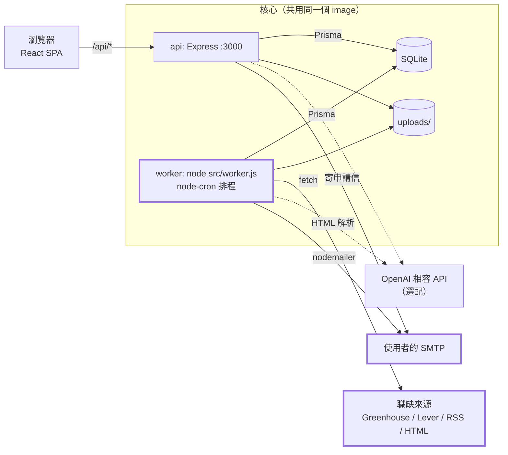
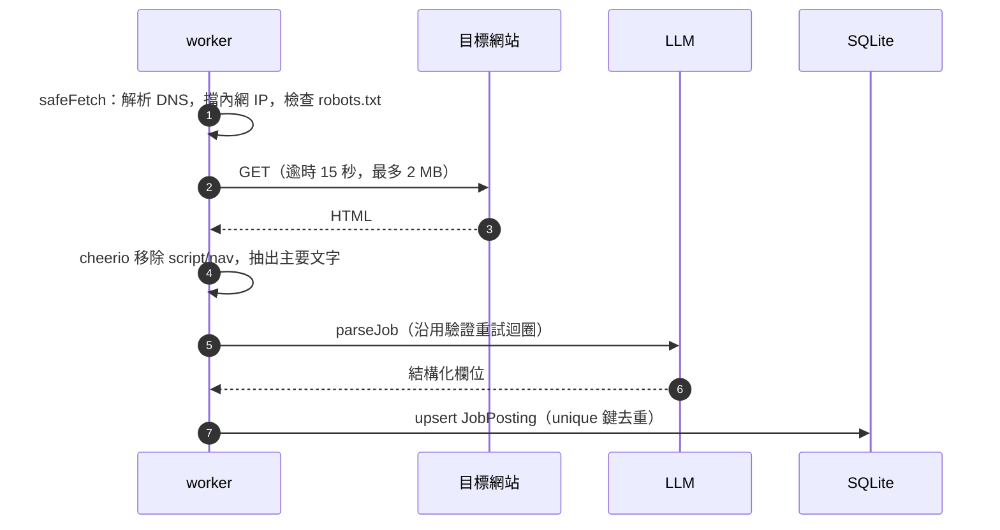
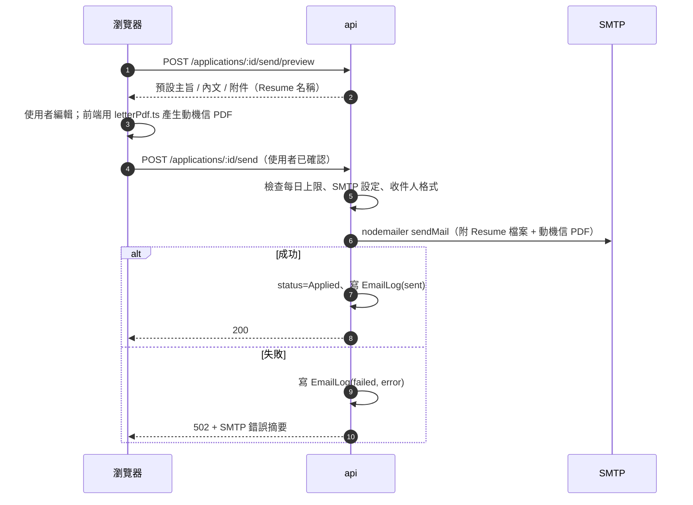

# Candivana 擴充計畫：Job Scout + Email

> 設計文件，尚未實作。依 commit `565d09b` 的程式碼撰寫；架構背景見 [NOTE.md](NOTE.md)。

**一句話：** 讓 Candivana 從「追蹤已知的申請」延伸成完整迴圈：**找職缺 → 一鍵轉成申請 → 寄出申請信 → 面試前提醒**，而且仍然自架、資料留在本機。

---

## 1. 為什麼要做

目前每一筆 `Application` 都要手動輸入（或貼職缺文字給 `/ai/parse-job`）。使用者實際的流程是：

1. 每天到好幾個求職網站搜尋同樣的關鍵字
2. 把有興趣的職缺複製進 Candivana
3. 到 Gmail 另外寫信、附上 CV 和動機信
4. 自己記得面試時間

第 1、3、4 步都在 Candivana 外面完成。這次擴充就是把這三步搬進來。

NOTE.md §2 寫過一個設計賭注：**「不需要背景工作 → 沒有 queue、cron、寄信」**。這次擴充會推翻這個假設，所以要新增一個背景 worker 行程（見 §4）。

---

## 2. 功能總覽

### 2.1 Job Scout（爬職缺）

| 功能 | 說明 |
|---|---|
| 儲存搜尋 | 關鍵字、地點、合約類型、來源清單、抓取頻率 |
| 排程抓取 | worker 依頻率執行，也可以手動按「立即執行」 |
| 去重 | 用 `(userId, source, externalId)` 判斷，同一職缺不會出現兩次 |
| Job Inbox | 新的職缺列表，可以標記 saved、dismissed |
| 一鍵轉申請 | 建立一筆 `Application`（status = `To Apply`），自動帶入 `link`、`platform`、`salary`、`contractType` |

**來源有兩種，透過可插拔的 adapter 支援：**

- **公開 API / RSS**（優先使用，穩定也合規）：Greenhouse Job Board API、Lever Postings API、一般 RSS/Atom feed（例如 Indeed RSS、Welcome to the Jungle）
- **任意網址 + AI 解析**：抓取 HTML、抽出文字，再交給現有的 `/ai/parse-job` 驗證重試迴圈轉成結構化資料

### 2.2 Email

每位使用者自己設定 SMTP（例如 Gmail App Password、Fastmail、自架 Postfix），跟現在 AI endpoint 一樣是「自帶設定」模式。沒有設定 SMTP 時，寄信功能回 400，其他功能照常運作。

| 用途 | 觸發方式 | 收件人 | 對應偏好 |
|---|---|---|---|
| **寄申請信給 HR** | 使用者按鈕，**預覽並確認後才寄** | 招募方 | — |
| **職缺快報（digest）** | worker 每天在 `digestHour` 寄出 | 自己 | `User.notifyDigest` |
| **面試提醒** | worker 在 stage 日期前 `reminderLeadHours` 小時寄出 | 自己 | `User.notifyReminders` |

> `notifyEmail`、`notifyReminders`、`notifyDigest` 已經在 schema 裡，也可以透過 [auth.routes.js:85](backend/src/routes/auth.routes.js#L85) 讀寫，只是目前沒有任何程式根據它們動作。這次擴充讓這些欄位真正生效。

---

## 3. 跟現有架構怎麼銜接

| 現有元件 | 新功能怎麼用它 |
|---|---|
| `Application`（[schema.prisma](backend/prisma/schema.prisma)） | 仍是中心。`JobPosting` 轉換後就成為一筆 `Application`，用 `applicationId` 回連 |
| AI 驗證迴圈（[ai.routes.js:66](backend/src/routes/ai.routes.js#L66)、[aiClient.js](backend/src/lib/aiClient.js)） | 把 `parse-job` 的核心邏輯抽成 `lib/parseJob.js`，讓 HTML adapter 和原本的路由共用 |
| CV 庫（`Resume.filePath`，[uploads.js](backend/src/lib/uploads.js)） | 申請信直接附上關聯的 `Resume` 檔案 |
| 動機信（`LetterVersion`） | 附件 PDF：見下方的取捨 |
| 身分驗證（[middleware/auth.js](backend/src/middleware/auth.js)） | 所有新路由都用 `authenticateToken`，查詢一律帶 `userId` |
| 測試（[tests/helpers.js](backend/tests/helpers.js)） | 新路由沿用 vitest + supertest 的寫法 |

**動機信 PDF 的取捨：** 目前 PDF 在前端用 jsPDF 產生（[letterPdf.ts](frontend/src/lib/letterPdf.ts)），伺服器沒有 PDF 引擎。

- **方案 A（建議）**：寄信對話框由前端產生 PDF，跟寄信請求一起上傳。所見即所得，後端不用加依賴。
- 方案 B：後端加 PDF 產生器。worker 可以自己產生，但版面會跟前端預覽分成兩份程式碼，容易不一致。

寄申請信一定要使用者在瀏覽器裡確認，所以方案 A 沒有缺點。

---

## 4. 系統全貌（新增部分以粗框標示）



**設計決策：**

- **worker 是獨立行程，但用同一個 image**：API 的請求延遲不會被爬蟲拖慢；部署時只要在 compose 多加一個 service。
- **不加 Redis**：SQLite 一次只能有一個寫入者，資料量也小。排程狀態直接記在 DB（`JobSearch.lastRunAt`、`ApplicationStage.reminderSentAt`），worker 每分鐘掃一次「到期了嗎」。
- **冪等**：每封提醒或快報寄出前先寫 `EmailLog`，寄出後再更新狀態。worker 重啟不會重複寄信。
- **寄申請信走 API 同步處理**：使用者正在等結果，要馬上看到成功或錯誤訊息。

---

## 5. 資料模型（Prisma 新增 / 修改）

```prisma
model JobSearch {
  id         Int       @id @default(autoincrement())
  userId     Int
  user       User      @relation(fields: [userId], references: [id], onDelete: Cascade)
  name       String
  query      String              // 關鍵字
  location   String?
  contractType String?
  sources    String   @default("[]") // JSON：[{ type: "greenhouse", board: "acme" }, { type: "rss", url: "..." }]
  frequencyMin Int    @default(1440) // 抓取間隔（分鐘），下限由 SCRAPER_MIN_INTERVAL_MIN 決定
  isActive   Boolean  @default(true)
  lastRunAt  DateTime?
  lastError  String?
  postings   JobPosting[]
  createdAt  DateTime @default(now())
  updatedAt  DateTime @updatedAt
}

model JobPosting {
  id          Int       @id @default(autoincrement())
  userId      Int
  user        User      @relation(fields: [userId], references: [id], onDelete: Cascade)
  searchId    Int?
  search      JobSearch? @relation(fields: [searchId], references: [id], onDelete: SetNull)
  source      String              // "greenhouse" | "lever" | "rss" | "html"
  externalId  String              // 來源給的 id；沒有的話用 url 的 hash
  url         String
  company     String
  title       String
  location    String?
  salary      String?
  contractType String?
  description String?
  postedAt    DateTime?
  status      String   @default("new") // new | saved | dismissed | converted（由 validators.js 檢查）
  applicationId Int?   @unique
  application Application? @relation(fields: [applicationId], references: [id], onDelete: SetNull)
  digestedAt  DateTime?            // 已經放進哪一次快報
  createdAt   DateTime @default(now())

  @@unique([userId, source, externalId])
}

model EmailLog {
  id            Int      @id @default(autoincrement())
  userId        Int
  user          User     @relation(fields: [userId], references: [id], onDelete: Cascade)
  type          String               // application | digest | reminder | test
  to            String
  subject       String
  status        String   @default("pending") // pending | sent | failed
  error         String?
  applicationId Int?
  stageId       Int?
  createdAt     DateTime @default(now())
  sentAt        DateTime?
}
```

**修改現有 model：**

```prisma
model User {
  // ...現有欄位
  smtpHost          String?
  smtpPort          Int?
  smtpSecure        Boolean @default(true)
  smtpUser          String?
  smtpPassEnc       String?   // 用 ENCRYPTION_KEY 加密，不存明文
  smtpFrom          String?   // "Your Name <you@example.com>"
  digestHour        Int     @default(8)   // 使用者時區的整點
  timezone          String  @default("UTC")
  reminderLeadHours Int     @default(24)
  dailySendLimit    Int     @default(20)  // 寄給 HR 的每日上限
}

model ApplicationStage {
  // ...現有欄位
  reminderSentAt DateTime?
}

model Application {
  // ...現有欄位
  contactEmail String?   // HR / 招募方的 email
  jobPosting   JobPosting?
}
```

> 目前 schema 是用 `prisma db push` 同步，沒有 migration 檔（NOTE.md §10 #6）。這次新增的欄位都是 nullable 或有預設值，`db push` 可以安全套用。建議趁這次改用 `prisma migrate`。

---

## 6. Source adapter

```
backend/src/scrapers/
├── index.js        # 依 source.type 分派，統一限速、逾時、User-Agent
├── greenhouse.js   # GET https://boards-api.greenhouse.io/v1/boards/{board}/jobs?content=true
├── lever.js        # GET https://api.lever.co/v0/postings/{company}?mode=json
├── rss.js          # rss-parser
├── html.js         # fetch → cheerio 抽文字 → lib/parseJob.js（AI）
└── safeFetch.js    # SSRF 防護、robots.txt 檢查、回應大小上限
```

所有 adapter 都實作同一個介面：

```js
/**
 * @param {object} source  JobSearch.sources 裡的一項
 * @param {object} search  { query, location, contractType }
 * @param {object} ctx     { user, signal }，HTML adapter 需要 user 的 AI 設定
 * @returns {Promise<NormalizedJob[]>}
 */
export async function fetchJobs(source, search, ctx) {}

// NormalizedJob = { externalId, url, company, title, location?, salary?, contractType?, description?, postedAt? }
```

**HTML adapter 的流程：**



API adapter 會先在本地用 `query`、`location` 過濾，因為 Greenhouse 和 Lever 的公開 API 都是回傳整個 board 的職缺。

---

## 7. API 規劃

所有路由都需要 `authenticateToken`，查詢一律帶 `userId`。不是自己的資料回 404（沿用現有的 P2025 處理）。

### Job Scout

| Method | Path | 說明 |
|---|---|---|
| GET | `/job-searches` | 列出儲存的搜尋 |
| POST | `/job-searches` | 新增 |
| PUT | `/job-searches/:id` | 修改 |
| DELETE | `/job-searches/:id` | 刪除（底下的 posting 保留，`searchId` 設為 null） |
| POST | `/job-searches/:id/run` | 立即執行一次（有冷卻時間） |
| GET | `/job-postings?status=new&searchId=` | Inbox 列表 |
| PATCH | `/job-postings/:id` | 改 status（saved / dismissed） |
| POST | `/job-postings/:id/convert` | 建立 `Application`，回傳新的 application |

### Email

| Method | Path | 說明 |
|---|---|---|
| GET | `/email/settings` | 回傳 SMTP 設定（**不回密碼**，只回 `hasPassword: true`） |
| PUT | `/email/settings` | 儲存 SMTP 設定與通知偏好 |
| POST | `/email/test` | 寄一封測試信給自己 |
| POST | `/applications/:id/send/preview` | 產生預設主旨、內文、附件清單（不寄出） |
| POST | `/applications/:id/send` | multipart：`to`、`subject`、`body`、`letterPdf`（選配）。寄出成功後把 status 改成 `Applied`、`appliedDate` 設為現在，並寫入 `EmailLog` |
| GET | `/email/logs` | 寄送紀錄 |

**寄申請信的流程：**



---

## 8. 前端

| 位置 | 改動 |
|---|---|
| 側邊欄 | 新增 **Job Inbox** view（顯示新職缺數量的 badge） |
| Job Inbox | 左側是搜尋清單，右側是職缺卡片：Save / Dismiss / **Add to board** / 開啟原網址 |
| 搜尋編輯器 | 關鍵字、地點、來源（Greenhouse board 名稱、Lever 公司 slug、RSS URL、任意 URL）、頻率 |
| Settings | 新增 **Email** 區塊：SMTP 表單、「寄測試信」、digest 時間、時區、提醒提前時數、通知開關 |
| Application 詳情 | 新增 `contactEmail` 欄位與 **Send application** 按鈕 → 寄信對話框（收件人、主旨、內文、附件預覽） |
| 申請卡片 | 已寄出的申請顯示 ✉️ 圖示與寄送時間 |

前端目前沒有 router，都靠 `App.tsx` 的 `view` state 切換（NOTE.md §8）。Job Inbox 照同樣方式加一個 view，自己抓自己的資料（跟 `LettersView` 一樣）。

---

## 9. 部署與設定

### docker-compose 新增 worker

```yaml
  worker:
    container_name: candivana-worker
    build: ./backend
    volumes:
      - ./backend:/app
      - /app/node_modules
      - ./data:/app/data
      - ./uploads:/app/uploads
    environment:
      - DATABASE_URL=file:/app/data/dev.db
      - ENCRYPTION_KEY=${ENCRYPTION_KEY:?ENCRYPTION_KEY must be set}
      - SCRAPER_USER_AGENT=${SCRAPER_USER_AGENT:-CandivanaBot/1.0 (+self-hosted)}
      - SCRAPER_MIN_INTERVAL_MIN=${SCRAPER_MIN_INTERVAL_MIN:-60}
    command: sh -c "npx prisma generate && node src/worker.js"
    depends_on:
      - api
```

`docker-compose.prod.yml` 也要加上同樣的 service，改用 named volume `api-data`、`api-uploads`。

### 新增環境變數

| 變數 | 必填 | 說明 |
|---|---|---|
| `ENCRYPTION_KEY` | 是 | 32 bytes base64，用來加密 SMTP 密碼。`make init` 自動產生 |
| `SCRAPER_USER_AGENT` | 否 | 爬蟲的 User-Agent |
| `SCRAPER_MIN_INTERVAL_MIN` | 否 | 每個搜尋最短抓取間隔，預設 60 |
| `ENABLE_WORKER` | 否 | 設成 `false` 時 worker 啟動後直接退出（給不想要背景工作的人） |

### 新增依賴（backend）

`nodemailer`、`node-cron`、`rss-parser`、`cheerio`

---

## 10. 安全與合規

這幾點對應 NOTE.md §10 已經指出的架構張力，新功能不能讓它們更嚴重：

| 風險 | 對策 |
|---|---|
| **SSRF**：使用者給任意 URL，伺服器就會去抓（NOTE §10 #3 的同類問題） | `safeFetch` 先解析 DNS，擋私有 IP、loopback、link-local、metadata IP（169.254.169.254）；不跟隨轉址到內網；限制回應大小和逾時 |
| **網站 ToS / robots.txt** | 預設遵守 robots.txt；每個網域加限速；**不支援需要登入的網站（例如 LinkedIn）**；優先使用官方公開 API |
| **憑證明文**：現有 `aiApiKey` 是明文存放 | SMTP 密碼用 AES-256-GCM 加密存放；API 永遠不回傳密碼。建議 `aiApiKey` 之後也改用同一套機制 |
| **被當成垃圾信工具** | 寄給 HR 一律要使用者手動確認；沒有批次寄送；`dailySendLimit` 限制每日數量；所有寄送都記在 `EmailLog` |
| **Email header injection** | 收件人、主旨用 nodemailer 的參數傳入，不自己拼 header；寄送前驗證 email 格式 |
| **刪帳號殘留**（NOTE §10 #4） | `JobSearch`、`JobPosting`、`EmailLog` 都設 `onDelete: Cascade` |

---

## 11. 分階段實作

| 階段 | 範圍 | 為什麼這樣排 |
|---|---|---|
| **Phase 1** | SMTP 設定 + 加密、`/email/test`、worker 骨架、**面試提醒** | 範圍最小，先驗證 worker、排程、冪等寄信這套基礎 |
| **Phase 2** | Job Scout：`JobSearch` / `JobPosting`、Greenhouse / Lever / RSS adapter、Job Inbox、convert、**職缺快報** | 提供核心價值，而且只用到穩定的公開 API |
| **Phase 3** | HTML + AI adapter（含 `safeFetch`）、**寄申請信給 HR** | 風險最高（SSRF、對外寄信），放在基礎穩定之後 |

每個階段都可以單獨合併、單獨上線。

---

## 12. 測試計畫

- **路由**：vitest + supertest，沿用 [tests/helpers.js](backend/tests/helpers.js) 建立使用者。每個新路由都要測「別人的資料回 404」。
- **Adapter**：把 Greenhouse、Lever、RSS 的回應存成 fixture 測試，不打真實網路。
- **safeFetch**：測試 `127.0.0.1`、`10.x`、`169.254.169.254`、DNS rebinding、轉址到內網都會被擋。
- **寄信**：測試時用 nodemailer 的 `jsonTransport`；本機手動測試時在 compose 加 [Mailpit](https://github.com/axllent/mailpit) 當假的 SMTP。
- **worker 冪等**：同一個 stage 連續跑兩次排程，只會寄出一封提醒。
- **CI**：沿用 [ci.yml](.github/workflows/ci.yml)，不需要額外設定。

---

## 13. 不在這次範圍內

- 自動投遞（自動填寫求職網站表單）
- 讀取信箱 / 追蹤 HR 回信（IMAP）
- 需要登入的求職網站
- 推播通知（Telegram、Slack 等）。之後可以沿用同一套 `EmailLog` / 偏好設定擴充成多管道通知
