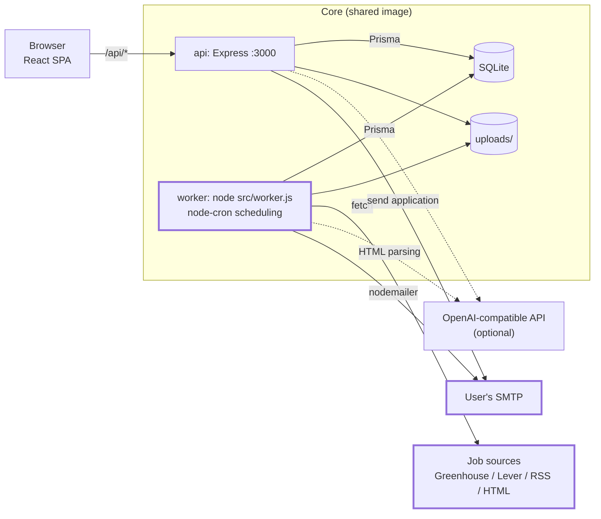
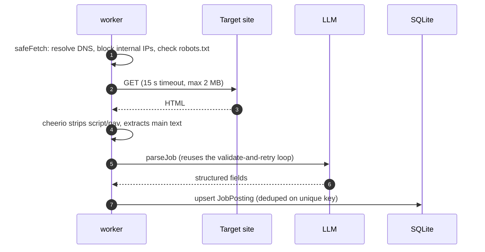

# Candivana Expansion Plan: Job Scout + Email

> Design document, not yet implemented. Written against the code at commit `565d09b`; see [NOTE.md](NOTE.md) for architecture background.

**In one sentence:** extend Candivana from "tracking applications you already know about" into a full loop: **find jobs → turn one into an application in one click → send the application email → get reminded before interviews**, while staying self-hosted with data kept locally.

---

## 1. Why

Today every `Application` is entered by hand (or by pasting job text into `/ai/parse-job`). The user's actual workflow is:

1. Search the same keywords on several job sites every day
2. Copy interesting postings into Candivana
3. Write an email separately in Gmail, attaching the CV and cover letter
4. Remember interview times themselves

Steps 1, 3 and 4 all happen outside Candivana. This expansion brings those three steps in.

NOTE.md §2 records a design bet: **"no background jobs needed → no queue, cron or email"**. This expansion overturns that assumption, so it adds a background scheduler. It runs inside the api process (see §4).

---

## 2. Feature overview

### 2.1 Job Scout (job scraper)

| Feature | Description |
|---|---|
| Saved searches | Keywords, location, contract type, source list, fetch frequency |
| Scheduled fetching | The worker runs on the configured frequency; there's also a manual "Run now" |
| Dedup | Keyed on `(userId, source, externalId)`, so the same posting never appears twice |
| Job Inbox | List of new postings that can be marked saved or dismissed |
| One-click convert | Creates an `Application` (status = `To Apply`), prefilling `link`, `platform`, `salary`, `contractType` |

**Two kinds of sources, supported through pluggable adapters:**

- **Public APIs / RSS** (preferred: stable and compliant): Greenhouse Job Board API, Lever Postings API, generic RSS/Atom feeds (e.g. Indeed RSS, Welcome to the Jungle)
- **Any URL + AI parsing**: fetch the HTML, extract the text, and hand it to the existing `/ai/parse-job` validate-and-retry loop to turn it into structured data

### 2.2 Email

Each user configures their own SMTP (e.g. Gmail App Password, Fastmail, self-hosted Postfix), following the same "bring your own config" model as the AI endpoint. Without SMTP configured, sending returns 400 and everything else keeps working.

| Use | Trigger | Recipient | Preference |
|---|---|---|---|
| **Send application to HR** | User clicks a button; **sent only after preview and confirmation** | The recruiter | — |
| **Job digest** | Worker sends daily at `digestHour` | Self | `User.notifyDigest` |
| **Interview reminder** | Worker sends `reminderLeadHours` hours before the stage date | Self | `User.notifyReminders` |

> `notifyEmail`, `notifyReminders` and `notifyDigest` are already in the schema and can be read/written via [auth.routes.js:85](backend/src/routes/auth.routes.js#L85), but nothing acts on them yet. This expansion makes them real.

---

## 3. How it connects to the existing architecture

| Existing component | How the new features use it |
|---|---|
| `Application` ([schema.prisma](backend/prisma/schema.prisma)) | Still the center. A converted `JobPosting` becomes an `Application`, linked back via `applicationId` |
| AI validation loop ([ai.routes.js:66](backend/src/routes/ai.routes.js#L66), [aiClient.js](backend/src/lib/aiClient.js)) | Extract the core of `parse-job` into `lib/parseJob.js`, shared by the HTML adapter and the existing route |
| CV library (`Resume.filePath`, [uploads.js](backend/src/lib/uploads.js)) | The application email attaches the linked `Resume` file directly |
| Cover letters (`LetterVersion`) | Attachment PDF: see the trade-off below |
| Auth ([middleware/auth.js](backend/src/middleware/auth.js)) | All new routes use `authenticateToken`; every query is scoped by `userId` |
| Tests ([tests/helpers.js](backend/tests/helpers.js)) | New routes follow the existing vitest + supertest style |

**Cover-letter PDF trade-off:** PDFs are currently generated in the frontend with jsPDF ([letterPdf.ts](frontend/src/lib/letterPdf.ts)); the server has no PDF engine.

- **Option A (recommended)**: the send dialog generates the PDF in the frontend and uploads it with the send request. What you see is what you get, and the backend needs no new dependency.
- Option B: add a PDF generator to the backend. The worker could generate it itself, but the layout would live in two codebases and drift.

Sending an application always requires the user to confirm in the browser, so Option A has no downside.

---

## 4. System overview (new parts shown with thick borders)



> **Decision update (Job Scout MVP):** the scheduler runs **inside the api process** (`backend/src/scrapers/scheduler.js`, started from `src/index.js`), not as the separate `worker` shown above. Scraping is async network I/O that doesn't block Express's event loop, and a second process writing to the same SQLite file only adds lock contention. The tick loop is self-contained, so it can move to its own process later if email sending or the HTML adapter ever needs it. `node-cron` isn't used either: a one-minute `setInterval` checks `lastRunAt + frequencyMin` in the DB.

**Design decisions:**

- **~~The worker is a separate process but uses the same image~~** (superseded, see the note above): scraping can't slow down API request latency, and deployment just adds one service to compose.
- **No Redis**: SQLite has a single writer and the data is small. Schedule state lives in the DB (`JobSearch.lastRunAt`, `ApplicationStage.reminderSentAt`), and the worker checks "is anything due?" once a minute.
- **Idempotent**: before each reminder or digest is sent, an `EmailLog` row is written first and its status updated afterwards. Restarting the worker never sends duplicates.
- **Sending an application goes through the API synchronously**: the user is waiting and needs to see success or the error right away.

---

## 5. Data model (Prisma additions / changes)

```prisma
model JobSearch {
  id         Int       @id @default(autoincrement())
  userId     Int
  user       User      @relation(fields: [userId], references: [id], onDelete: Cascade)
  name       String
  query      String              // keywords
  location   String?
  contractType String?
  sources    String   @default("[]") // JSON: [{ type: "greenhouse", board: "acme" }, { type: "rss", url: "..." }]
  frequencyMin Int    @default(1440) // fetch interval (minutes); floor set by SCRAPER_MIN_INTERVAL_MIN
  isActive   Boolean  @default(true)
  lastRunAt  DateTime?
  lastError  String?
  postings   JobPosting[]
  createdAt  DateTime @default(now())
  updatedAt  DateTime @updatedAt
}

model JobPosting {
  id          Int       @id @default(autoincrement())
  userId      Int
  user        User      @relation(fields: [userId], references: [id], onDelete: Cascade)
  searchId    Int?
  search      JobSearch? @relation(fields: [searchId], references: [id], onDelete: SetNull)
  source      String              // "greenhouse" | "lever" | "rss" | "html"
  externalId  String              // id from the source; hash of the url if none
  url         String
  company     String
  title       String
  location    String?
  salary      String?
  contractType String?
  description String?
  postedAt    DateTime?
  status      String   @default("new") // new | saved | dismissed | converted (checked by validators.js)
  applicationId Int?   @unique
  application Application? @relation(fields: [applicationId], references: [id], onDelete: SetNull)
  digestedAt  DateTime?            // which digest it was included in
  createdAt   DateTime @default(now())

  @@unique([userId, source, externalId])
}

model EmailLog {
  id            Int      @id @default(autoincrement())
  userId        Int
  user          User     @relation(fields: [userId], references: [id], onDelete: Cascade)
  type          String               // application | digest | reminder | test
  to            String
  subject       String
  status        String   @default("pending") // pending | sent | failed
  error         String?
  applicationId Int?
  stageId       Int?
  createdAt     DateTime @default(now())
  sentAt        DateTime?
}
```

**Changes to existing models:**

```prisma
model User {
  // ...existing fields
  smtpHost          String?
  smtpPort          Int?
  smtpSecure        Boolean @default(true)
  smtpUser          String?
  smtpPassEnc       String?   // encrypted with ENCRYPTION_KEY, never stored in plaintext
  smtpFrom          String?   // "Your Name <you@example.com>"
  digestHour        Int     @default(8)   // hour in the user's timezone
  timezone          String  @default("UTC")
  reminderLeadHours Int     @default(24)
  dailySendLimit    Int     @default(20)  // daily cap on emails to HR
}

model ApplicationStage {
  // ...existing fields
  reminderSentAt DateTime?
}

model Application {
  // ...existing fields
  contactEmail String?   // HR / recruiter email
  jobPosting   JobPosting?
}
```

> The schema is currently synced with `prisma db push` and has no migration files (NOTE.md §10 #6). All new fields are nullable or have defaults, so `db push` can apply them safely. Switching to `prisma migrate` as part of this work is recommended.

---

## 6. Source adapters

```
backend/src/scrapers/
├── index.js        # dispatch on source.type; shared rate limit, timeout, User-Agent
├── greenhouse.js   # GET https://boards-api.greenhouse.io/v1/boards/{board}/jobs?content=true
├── lever.js        # GET https://api.lever.co/v0/postings/{company}?mode=json
├── rss.js          # rss-parser
├── html.js         # fetch → cheerio text extraction → lib/parseJob.js (AI)
└── safeFetch.js    # SSRF protection, robots.txt check, response size cap
```

Every adapter implements the same interface:

```js
/**
 * @param {object} source  one entry from JobSearch.sources
 * @param {object} search  { query, location, contractType }
 * @param {object} ctx     { user, signal }; the HTML adapter needs the user's AI settings
 * @returns {Promise<NormalizedJob[]>}
 */
export async function fetchJobs(source, search, ctx) {}

// NormalizedJob = { externalId, url, company, title, location?, salary?, contractType?, description?, postedAt? }
```

**HTML adapter flow:**



API adapters filter locally on `query` and `location` first, because the Greenhouse and Lever public APIs return every posting on the board.

---

## 7. API design

All routes require `authenticateToken`, and every query is scoped by `userId`. Other users' data returns 404 (reusing the existing P2025 handling).

### Job Scout

| Method | Path | Description |
|---|---|---|
| GET | `/job-searches` | List saved searches |
| POST | `/job-searches` | Create |
| PUT | `/job-searches/:id` | Update |
| DELETE | `/job-searches/:id` | Delete (postings are kept, `searchId` set to null) |
| POST | `/job-searches/:id/run` | Run once now (with a cooldown) |
| GET | `/job-postings?status=new&searchId=` | Inbox list |
| PATCH | `/job-postings/:id` | Change status (saved / dismissed) |
| POST | `/job-postings/:id/convert` | Create an `Application` and return it |

### Email

| Method | Path | Description |
|---|---|---|
| GET | `/email/settings` | Return SMTP settings (**never the password**, only `hasPassword: true`) |
| PUT | `/email/settings` | Save SMTP settings and notification preferences |
| POST | `/email/test` | Send a test email to yourself |
| POST | `/applications/:id/send/preview` | Generate default subject, body and attachment list (nothing sent) |
| POST | `/applications/:id/send` | multipart: `to`, `subject`, `body`, `letterPdf` (optional). On success, set status to `Applied`, `appliedDate` to now, and write `EmailLog` |
| GET | `/email/logs` | Send history |

**Application send flow:**

```mermaid
sequenceDiagram
    autonumber
    participant B as Browser
    participant A as api
    participant M as SMTP
    B->>A: POST /applications/:id/send/preview
    A-->>B: default subject / body / attachments (Resume name)
    B->>B: user edits; frontend generates cover-letter PDF with letterPdf.ts
    B->>A: POST /applications/:id/send (user confirmed)
    A->>A: check daily limit, SMTP settings, recipient format
    A->>M: nodemailer sendMail (Resume file + cover-letter PDF attached)
    alt success
        A->>A: status=Applied, write EmailLog(sent)
        A-->>B: 200
    else failure
        A->>A: write EmailLog(failed, error)
        A-->>B: 502 + SMTP error summary
    end
```

---

## 8. Frontend

| Location | Change |
|---|---|
| Sidebar | New **Job Inbox** view (with a badge for the new-posting count) |
| Job Inbox | Search list on the left, posting cards on the right: Save / Dismiss / **Add to board** / open original URL |
| Search editor | Keywords, location, sources (Greenhouse board name, Lever company slug, RSS URL, any URL), frequency |
| Settings | New **Email** section: SMTP form, "Send test email", digest hour, timezone, reminder lead hours, notification toggles |
| Application detail | New `contactEmail` field and a **Send application** button → send dialog (recipient, subject, body, attachment preview) |
| Application card | Sent applications show a ✉️ icon and the send time |

The frontend has no router; views switch via the `view` state in `App.tsx` (NOTE.md §8). Job Inbox is added the same way, as a view that fetches its own data (like `LettersView`).

---

## 9. Deployment and configuration

### Add the worker to docker-compose

> Superseded for the Job Scout MVP: no extra service is needed, since the scheduler runs inside `api`. Kept for reference in case the worker is split out later.

```yaml
  worker:
    container_name: candivana-worker
    build: ./backend
    volumes:
      - ./backend:/app
      - /app/node_modules
      - ./data:/app/data
      - ./uploads:/app/uploads
    environment:
      - DATABASE_URL=file:/app/data/dev.db
      - ENCRYPTION_KEY=${ENCRYPTION_KEY:?ENCRYPTION_KEY must be set}
      - SCRAPER_USER_AGENT=${SCRAPER_USER_AGENT:-CandivanaBot/1.0 (+self-hosted)}
      - SCRAPER_MIN_INTERVAL_MIN=${SCRAPER_MIN_INTERVAL_MIN:-60}
    command: sh -c "npx prisma generate && node src/worker.js"
    depends_on:
      - api
```

`docker-compose.prod.yml` needs the same service, using the named volumes `api-data` and `api-uploads`.

### New environment variables

| Variable | Required | Description |
|---|---|---|
| `ENCRYPTION_KEY` | Yes | 32 bytes base64, used to encrypt SMTP passwords. Generated by `make init` |
| `SCRAPER_USER_AGENT` | No | User-Agent for the scraper |
| `SCRAPER_MIN_INTERVAL_MIN` | No | Minimum fetch interval per search, default 60 |
| `ENABLE_SCHEDULER` | No | When `false`, the api doesn't start the Job Scout scheduler (replaces `ENABLE_WORKER`) |

### New dependencies (backend)

Job Scout MVP: `rss-parser` only. Later phases: `nodemailer` (email) and `cheerio` (HTML adapter). `node-cron` isn't needed.

---

## 10. Security and compliance

These map to architectural tensions already noted in NOTE.md §10; the new features must not make them worse:

| Risk | Mitigation |
|---|---|
| **SSRF**: the user supplies any URL and the server fetches it (same class as NOTE §10 #3) | `safeFetch` resolves DNS first and blocks private IPs, loopback, link-local and the metadata IP (169.254.169.254); never follows redirects into internal networks; caps response size and timeout |
| **Site ToS / robots.txt** | Respect robots.txt by default; rate-limit per domain; **no support for sites that require login (e.g. LinkedIn)**; prefer official public APIs |
| **Plaintext credentials**: the existing `aiApiKey` is stored in plaintext | SMTP passwords are stored encrypted with AES-256-GCM; the API never returns them. Recommend moving `aiApiKey` to the same mechanism later |
| **Abuse as a spam tool** | Emails to HR always require manual confirmation; no bulk sending; `dailySendLimit` caps daily volume; every send is recorded in `EmailLog` |
| **Email header injection** | Recipient and subject are passed as nodemailer parameters, never hand-built headers; email format is validated before sending |
| **Leftovers after account deletion** (NOTE §10 #4) | `JobSearch`, `JobPosting` and `EmailLog` all use `onDelete: Cascade` |

---

## 11. Phased implementation

| Phase | Scope | Why this order |
|---|---|---|
| **Phase 1** | SMTP settings + encryption, `/email/test`, worker skeleton, **interview reminders** | Smallest scope; validates the worker, scheduling and idempotent sending foundation first |
| **Phase 2** | Job Scout: `JobSearch` / `JobPosting`, Greenhouse / Lever / RSS adapters, Job Inbox, convert, **job digest** | Delivers the core value using only stable public APIs |
| **Phase 3** | HTML + AI adapter (with `safeFetch`), **sending applications to HR** | Highest risk (SSRF, outbound email), so it comes after the foundation is stable |

Each phase can be merged and shipped on its own.

---

## 12. Test plan

- **Routes**: vitest + supertest, creating users with [tests/helpers.js](backend/tests/helpers.js). Every new route tests "other users' data returns 404".
- **Adapters**: Greenhouse, Lever and RSS responses saved as fixtures; no real network.
- **safeFetch**: `127.0.0.1`, `10.x`, `169.254.169.254`, DNS rebinding and redirects into internal networks are all blocked.
- **Email**: tests use nodemailer's `jsonTransport`; for local manual testing, add [Mailpit](https://github.com/axllent/mailpit) to compose as a fake SMTP server.
- **Worker idempotency**: running the schedule twice for the same stage sends only one reminder.
- **CI**: reuse [ci.yml](.github/workflows/ci.yml); no extra setup needed.

---

## 13. Out of scope

- Auto-applying (automatically filling job-site forms)
- Reading the inbox / tracking HR replies (IMAP)
- Job sites that require login
- Push notifications (Telegram, Slack, etc.). These can later reuse the same `EmailLog` / preferences to become multi-channel notifications
